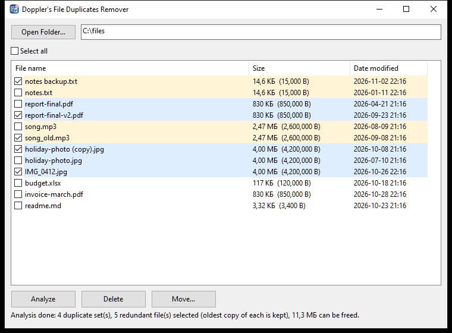

# Doppler's File Duplicates Remover

A small standalone Windows app (pure C++ / Win32, single exe, no dependencies) that finds and removes duplicate files in a folder.

## Use
1. **Open Folder...** (or paste a path) to list the files in a folder.
2. **Analyze** finds files with identical content, ignoring names and dates, and ticks all but the oldest copy in each set.
3. **Delete** sends the ticked files to the Recycle Bin (after confirmation), or **Move...** moves them to another folder (never overwrites; renames to `name (2).ext` on conflict).

Click a column header to sort by name, size or date. Only the selected folder is scanned, not subfolders. Empty files are skipped.

## How duplicates are detected
1. Group by exact file size (no I/O for files with a unique size).
2. Hash the first 64 KB within each size group.
3. Byte-for-byte comparison of the remaining candidates, so there are no false positives.

## Build
Requires the w64devkit (MinGW-w64) toolchain; adjust the path in `build.bat`, then run it. Output: `DopplersFileDuplicatesRemover.exe`.

The exe is unsigned, so Windows SmartScreen may show an "unrecognized app" prompt.
